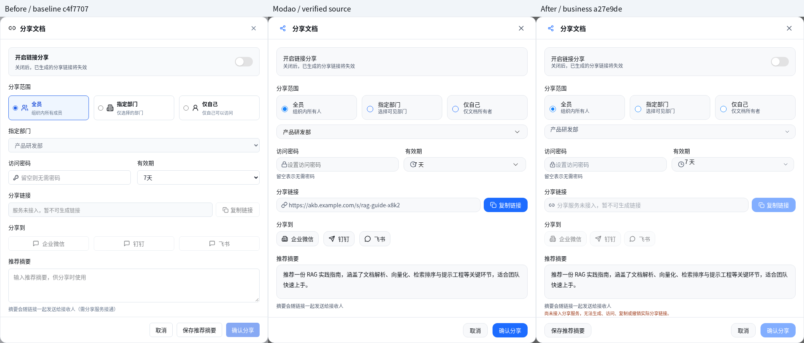
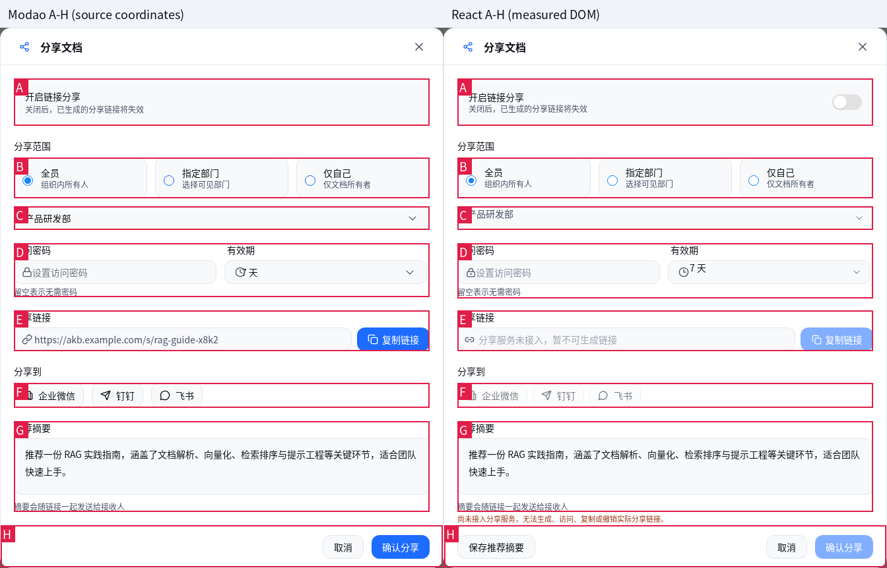

# PR #14：V15 分享窗口独立回归报告

验收日期：2026-11-05 UTC。复用原 Codex Cloud、原仓库、原墨刀 ZIP、系统 Chromium 和原 Playwright 工程，未创建测试项目。

## 结论与版本

**V15 本地草稿/推荐摘要流程可供人工复核。真实分享功能尚未完成，未接入服务。** 类型检查、开发构建、既有 21 项和新增 19 项浏览器回归全部通过。没有将禁用动作或本地摘要保存当作真实分享成功。

- 分支：`feat/modao-v15-share-dialog`。
- 独立验收起点 / 原 PR #14 head：`c4f7707a8e4a5b4248809734657a8d01af6f558a`；检出前工作树干净，原分支为 PR #12 验收结果 `d51c7f193fad95b55de49396a7603d9643f2d703`。
- 最终受测业务代码：`a27e9def3bca1f0cc286a823e1388b779d38e212`。
- 修复提交：`92a770e7630b9c48f021cdaa8299eef9bfc883d1`（V15 还原/审计/焦点/状态）、`36d4cb218bc939c671827d52179ab089a6d0ec04`（底栏键盘顺序）、`a27e9de`（摘要内边距与无焦点对照采集）。报告/证据提交在其后，不再改变业务代码。
- Node.js `v24.22.1`；npm `11.9.0`；`/usr/bin/chromium` `155.0.8059.79`。
- 统一基准：1920×1080、DPR 1、浏览器缩放 100%、zh-CN。原生截图与共同字体 Noto Sans CJK SC 截图分别保留。窄屏用例明确使用额外视口，未混入基准图。
- 未修改 main、未合并 PR、未连接生产服务，全部为独立 context 的本地合成数据。

## 命令与结果

完整参数、工作目录、退出码见证据 `commands.json`；完整输出见 `logs/`。没有删除/跳过失败断言，没有静态检查替代浏览器。

| 命令 | 原始 PR #14 | 最终受测代码 |
| --- | --- | --- |
| `npm run typecheck` | 退出 0 | 退出 0 |
| `npm run build:dev` | 退出 0 | 退出 0 |
| `node scripts/modao-pr11-regression.mjs` | 6/6，退出 0 | 6/6，退出 0 |
| `node scripts/modao-v16-regression.mjs` | 15/15，退出 0 | 15/15，退出 0 |
| `node scripts/modao-v15-regression.mjs` | 14/18，退出 1 | 19/19，退出 0 |
| `node scripts/modao-v15-visual-capture.mjs` | — | 3 组截图/几何，退出 0 |
| `node scripts/modao-v15-v16-plan-capture.mjs` | 复用已有证据 | 离线原型重新采集，退出 0 |

最初 V15 为 15 项专项 + 3 项知识管理，其中专项 11/15；新增真实鼠标有效期菜单用例后，最终 **V15 16/16 + 知识管理 3/3**。既有 **B01/B02/B03/B05 6/6 + V16 15/15 = 21/21**。中间复测的日志/JSON 另存，不覆盖原始失败。

开发构建成功，依赖打包过程的 module-level directive 提示保留在原日志。本轮未要求、也未宣称运行完整 `npm test`。开发服务器复用已运行的 `npm run dev`（8080），原型服务器复用 8081。

## 原始失败及修复

以下四项均在原始 PR #14 上通过真实浏览器复现，`pageerror` 为 0；不是初始化文件缺失或网络代理导致的断言误报。原始失败截图、trace、results.json 与退出 1 的完整 stdout 保存在诊断包。

| 优先级 / 问题 | 最短复现步骤 / 原始错误 | 修复与复测证据 |
| --- | --- | --- |
| P1：本地摘要误记成分享操作 | 知识管理→分享→填摘要→鼠标点保存；审计 action 为 `分享文档`、result 为 `已记录附言`，触发 `Local summary save must not be audited as real sharing` | `store.ts` 仅修改该条审计文案为“保存推荐摘要 / 已本地保存，未创建分享链接”；`summary-save` 通过，真实分享仍禁用 |
| P2：摘要改动后仍提示已保存 | 保存 A→修改为未保存 B；触发 `Edited draft must not retain saved-success status` | 编辑摘要时清除保存状态及旧成功文案；`summary-dirty-status` 通过 |
| P2：关闭后焦点未返回分享入口 | 鼠标开窗→Tab→Escape；`Restore actual share trigger focus: false !== true` | 因该独立 Radix 窗口没有 Dialog.Trigger，记录真实打开按钮并在关闭时恢复；`keyboard-focus` 通过 |
| P2：字段文案与组件布局偏离原型 | 开窗后等待“组织内所有人”超时 5000ms；初始卡片额外图标/蓝底高亮、粗体、可见部门标题、后续字段位置、渠道尺寸、摘要和底栏均可见差异 | 恢复原型字段文案、卡片/输入背景、圆角、边框、间距、字段锚点、标题/密码/时钟/渠道图标与底栏；`layout-fields`、结构图与全部交互复测通过 |

**原始窗口外框已是 672×820、(752,130)，未将其误报成尺寸错误。** 主要偏差来自内部组件。共享状态仍只保存推荐摘要；没有新增密码、授权或有效期持久化。

随后人工复核还发现底栏视觉“保存→取消”与 DOM Tab 顺序相反，已调整 DOM 顺序并补真实 Tab 断言；摘要文字左右内边距再由 14px 校准为 16px。最后一次上述所有检查在 `a27e9de` 上重跑。没有改动 V16 业务代码，也没有为了通过回归改动已有 PR #11 / V16 脚本。

## V15 与知识管理浏览器明细

每个用例新建 browser context，通过鼠标/键盘真实页面操作，输出独立 trace；存储读取仅用于验证副作用。敏感性测试使用可辨识的合成密码，不是真实凭证。

| 用例 | 覆盖范围 | 最终结果 |
| --- | --- | --- |
| `layout-fields` | 672×820，(752,130)，默认值、字段可访问名称与原型文案 | 通过 |
| `scope-department` | 全员/指定部门/仅自己；部门启用/禁用；唯一确认部门；重开重置 | 通过 |
| `expiry-values` | 7/30/90 天、永久四项实际控件值；菜单截图 | 通过 |
| `expiry-mouse` | 鼠标展开下拉菜单并点击 30 天 | 通过 |
| `summary-save` | 鼠标保存推荐摘要；刷新恢复；审计明确为本地保存 | 通过 |
| `summary-dirty-status` | 保存 A 后改为 B，不保留“已保存”的成功状态 | 通过 |
| `discard-cancel` | 取消丢弃未保存草稿并刷新确认 | 通过 |
| `discard-escape` | Escape 丢弃未保存草稿并刷新确认 | 通过 |
| `discard-close` | 右上角关闭丢弃未保存草稿并刷新确认 | 通过 |
| `discard-backdrop` | 鼠标点击遮罩丢弃未保存草稿并刷新确认 | 通过 |
| `password-lifetime` | 输入/保存摘要/关闭/重开/刷新，全量检查 localStorage、sessionStorage、审计无合成密码 | 通过 |
| `no-share-service` | 空 URL、无链接锚点；复制/三渠道/确认禁用，无成功提示，无 HTTP 写请求 | 通过 |
| `cross-document` | 文档 A/B 摘要分别保存，密码、范围、有效期不串文档 | 通过 |
| `keyboard-focus` | 36 次 Tab、10 次 Shift+Tab 不逃逸；方向键；底栏视觉顺序；Escape 返回原入口 | 通过 |
| `navigate-reset` | 离开知识管理再返回后草稿/密码重置 | 通过 |
| `viewport-fit` | 桌面、较小屏幕和手机视口内可访问，无水平溢出 | 通过 |
| `library-view-edit` | 鼠标查看、编辑，保存并刷新确认文档内容 | 通过 |
| `library-delete-restore` | 删除、回收站、恢复后重新可查看 | 通过 |
| `library-new-collection` | 新建知识库，刷新保留本地数据 | 通过 |

密码在输入、摘要保存、关闭和刷新阶段均扫描**全部 localStorage / sessionStorage 值**，另检查本地审计日志；均无合成密码。密码只存在对话框草稿内，关闭即清除。测试 trace 可能包含输入动作的合成测试字符串，不能将测试 trace 与产品持久化混为一谈。

无服务用例确认：URL 值为空、无可访问分享 `<a href>`；复制、企业微信、钉钉、飞书、确认分享禁用；没有“复制成功 / 分享成功 / 已分享”提示；观察期无 HTTP POST/PUT/PATCH/DELETE。原型演示 URL 不注入 React，不以伪造接口响应制造成功。

## 既有 21 项浏览器回归

| PR #11 用例 | 验证内容 | 结果 |
| --- | --- | --- |
| `profile` | B01：鼠标点击保存个人资料并刷新恢复 | 通过 |
| `review-approve` | B03：已通过审核单不再显示待处理 | 通过 |
| `review-reject` | B03：已拒绝审核单不再显示待处理 | 通过 |
| `dashboard-zero` | B02：全部处理后仪表盘显示 0，刷新仍为 0 | 通过 |
| `keys-new` | B05：创建演示密钥后直接刷新，持久化无完整密钥 | 通过 |
| `keys-legacy` | B05：旧版完整密钥迁移清理，保留非秘密元数据 | 通过 |

| V16 用例 | 验证内容 | 结果 |
| --- | --- | --- |
| `four-tabs-layout` | 四页签渲染/截图，768×620 与主要几何 | 通过 |
| `draft-save-reload` | 跨页签草稿保留，保存及刷新恢复 | 通过 |
| `discard-cancel` | 取消丢弃未保存草稿 | 通过 |
| `discard-close` | 关闭丢弃草稿 | 通过 |
| `discard-escape` | Escape 丢弃草稿 | 通过 |
| `discard-backdrop` | 遮罩关闭丢弃草稿 | 通过 |
| `keyboard-layering` | Tab/Shift+Tab、页签方向键与遮罩层级 | 通过 |
| `accessible-fields` | 字段可访问名称及绑定 | 通过 |
| `legacy-migration` | 旧版状态迁移 | 通过 |
| `partial-preferences-migration` | 偏好缺字段时补齐与保留已有值 | 通过 |
| `roles-permissions` | 角色切换和权限入口回归 | 通过 |
| `radio-keyboard` | 偏好选项方向键操作 | 通过 |
| `quick-entry-focus` | 快捷入口及关闭焦点恢复 | 通过 |
| `narrow-viewports` | 小视口可访问性 | 通过 |
| `select-mouse-options` | 实际鼠标展开/选择偏好菜单 | 通过 |

B02 以应用 hydration 完成后的持久化状态及界面为准，保留首次 SSR 值观察；最终待审核数为 0，刷新仍为 0。B05 同时覆盖新建密钥直接刷新和旧版秘密清理。V16 的角色权限、旧版迁移、页签草稿、鼠标菜单及键盘测试未受 V15 影响。

## 原型、React 与结构对照





[1920×1080 原型与 React 全视口并排图](pr14-v15-full-viewport.png)。原始单张均为 1920×1080，原型 editor/native/统一字体版本及 React native/统一字体版本均在最终证据包；对照图为派生图，不代替原图。

- 原始 ZIP SHA256：`8c585bc0e158a22603410dc2578bf6fe9b6e6207285b124dd4eaf45c0646603b`，15,462,702 bytes。
- 复用 PR #11 证据包 SHA256：`1bfcf3fba30d44e2f35b2c44fad1b66ba3fd06de7e0560d2c5c16716acefc37a`。先验证其中 manifest，再重新运行实际原型热点采集；V15 的 8 份截图/几何文件逐字节相同，见 `source-verification.json`。
- 原型来自真实离线运行 DOM/SVG，保留 editor 帧；用既有方法将实际 zoom-area 在 1920×1080 下以 1:1 采集，未用图片重绘或拼造原型。仍需对演示容器克隆渲染的局限保持区分。
- React 比较时只将摘要填成原型示例文字，保持**未保存草稿**；以鼠标点标题移除 textarea 焦点；密码为空。URL 始终为空、禁用状态不伪造。菜单打开状态另有同视口截图。

外框 (752,130,672,820) 完全一致。以下为 source geometry 与真实 React DOM 的 `(x,y,w,h)`：

| 锚点 | React 选择器 | 原型 | React | 差值 |
| --- | --- | --- | --- | --- |
| A | `.sd-enable` | `[773, 207, 630, 72]` | `[773, 207, 630, 72]` | `[0, 0, 0, 0]` |
| B | `.sd-scopes` | `[773, 327, 630, 62]` | `[773, 327, 630, 62]` | `[0, 0, 0, 0]` |
| C | `.sd-field.sd-department` | `[773, 401, 630, 36]` | `[773, 401, 630, 36]` | `[0, 0, 0, 0]` |
| D | `.sd-cols` | `[773, 457, 630, 82]` | `[773, 457, 630, 84]` | `[0, 0, 0, 2]` |
| E | `.sd-field.sd-link-field` | `[773, 559, 630, 62]` | `[773, 559, 630, 62]` | `[0, 0, 0, 0]` |
| F | `.sd-channel-buttons` | `[773, 669, 630, 38]` | `[773, 669, 630, 38]` | `[0, 0, 0, 0]` |
| G | `.sd-field.sd-summary` | `[773, 727, 630, 138]` | `[773, 727, 630, 138]` | `[0, 0, 0, 0]` |
| H | `.sd-footer` | `[753, 885, 670, 64]` | `[753, 885, 670, 64]` | `[0, 0, 0, 0]` |

D 为包住密码辅助文字的容器，React 高 2px；辅助文字已上移 2px、下游所有锚点一致，未造成可见字段位移。卡片/输入背景 `#f8f9fb`，边框 `#e2e6ec`，正文 `#0d1117`，次级文字 `#4a5568`，主色 `#1d6cff`；窗口圆角 16px、控件 12px，遮罩黑色 0.6。标题 16px/700，正文 14px/20，辅助文字 12px/16。字体原生版和替代版分别保留，未宣称 PingFang 原生像素签收。

**仍可见且刻意保留的差异**：原型示例链接/正常渠道色与 React 空链接/禁用渠道色；新增明确的无服务声明及本地保存摘要按钮；演示背景知识管理的既有内容、图标和布局与原型不同。未通过修改原型、伪链接、隐藏声明或启用假动作消除差异。原型运行时开关控件在克隆帧中的显示与 React 原生可操作控件不同；不能据此删除真实开关。`pixel-difference.png` 与半透明叠图仅作定位证据，**不是像素相似度验收通过证明**。

## 异常日志与环境界限

| 套件 | 页面运行时异常 | console error 条数 | failed request 条数 |
| --- | --- | --- | --- |
| pr11-final | 0 | 38 | 38 |
| v16-final | 0 | 48 | 48 |
| v15-final | 0 | 54 | 54 |

这些 console/request 错误全部来自 `fonts.googleapis.com`（外部字体）与 `grok.com/grok-app-builder/extensions.js`，`net::ERR_TUNNEL_CONNECTION_FAILED`。未过滤、未伪造为零，详见每例 JSON 与 trace。系统 Chromium 实际启动成功，本地页面/接口与持久化回归可运行。共同字体已使用本机安装的 Noto Sans CJK SC，未借缺字体掩盖断言失败；网络策略及原生 PingFang 缺失使严格原生字形像素签收仍有限制。

## 待人工确认 / 后续产品边界

1. P2：是否接受 Noto Sans CJK SC 替代 PingFang，或提供可用原型字体。当前只可进行共同字体下的结构与交互复核。
2. P2：无服务模式新增的本地保存按钮、服务说明及禁用颜色是否纳入正式设计；它们是诚实说明本地能力的适配，不是原型像素内容。
3. 真实部门来源目前只确认“产品研发部”；未补造部门、多部门授权及组织权限行为。
4. 分享服务接入后开关、范围、部门、有效期是否保存；密码策略、服务端鉴权、撤销/过期/错误重试规则、复制与渠道发送均需产品/API 约定。本轮不实现、不假定其成功。
5. 明确保存过摘要后，再取消只丢弃后续未保存草稿，不撤销之前显式保存；延续本地数据语义，若希望事务式保存需另行确认。
6. 系统 Chromium 155 的可定制 select 已实测；其他浏览器使用原生菜单回退，尚未做多浏览器签收。原型开关克隆帧显示差异不作为真实控件的产品定义。

## 下载、复现与证据完整性

- [最终回归证据 ZIP](pr14-v15-regression-evidence.zip)：`index.html` 离线画廊、原型/React 原图、结构/叠图/像素差图、40 项最终结果与 trace、完整日志、命令、来源、修复 patch、脚本、SHA256 manifest。
- [原始失败与中间验证 ZIP](pr14-v15-baseline-diagnostics.zip)：原始 18 项截图与 trace、4 项失败原始日志、既有 21 项原始结果及中间复测 JSON/日志。
- ZIP 自身哈希见同目录 `.sha256`。所有 PNG 解码校验、引用路径校验、ZIP CRC 以及独立浏览器打开画廊验证均完成；各包 `manifest.json` 可逐文件验证。解压后直接打开 `index.html`，图片可点击原尺寸查看。

复现（复用当前项目依赖与本机 Chromium，不连接生产）：

```bash
npm run dev
npm run typecheck
npm run build:dev
IKB_PR11_OUTPUT=artifacts/modao-v1/pr14-core node scripts/modao-pr11-regression.mjs
IKB_V16_OUTPUT=artifacts/modao-v1/pr14-v16 node scripts/modao-v16-regression.mjs
IKB_V15_OUTPUT=artifacts/modao-v1/pr14-v15 node scripts/modao-v15-regression.mjs
IKB_V15_VISUAL_OUTPUT=artifacts/modao-v1/pr14-visual node scripts/modao-v15-visual-capture.mjs
# 原型已在 8081 提供；复用既有脚本采集真实热点，不重建页面
IKB_PLAN_OUTPUT=artifacts/modao-v1/pr14-source node scripts/modao-v15-v16-plan-capture.mjs
```

原始 4 项失败可在隔离检出 `c4f7707` 后使用证据脚本相同断言复现；最终脚本比原始轮次多 1 项鼠标菜单，并增加底栏 Tab 顺序断言，必须区分 18 与 19 的计数。没有为了验收改写业务规则。
