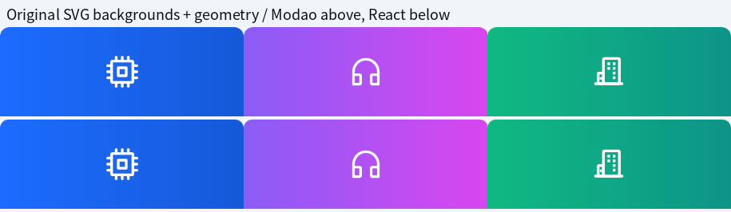
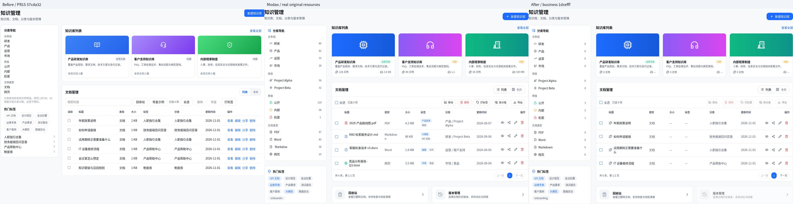
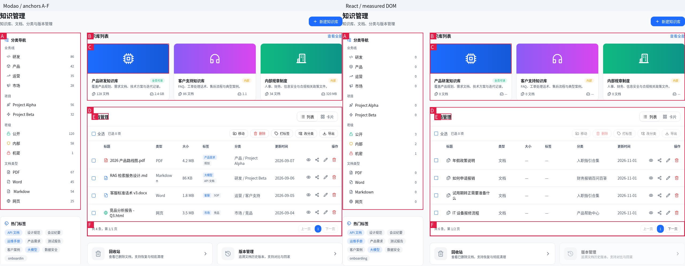

# PR #15：知识管理高保真复刻独立验收

日期：2026-11-05 UTC。复用原 Codex Cloud、仓库、完整墨刀 ZIP、8080 React / 8081 原型服务器、系统 Chromium 与 Playwright 依赖；未创建新项目。

## 结论与 Commit

**原型知识管理正文的主要结构与真实资源已还原，可供人工视觉复核；不等同整页像素级最终签收。** TypeScript、开发构建均退出 0；PR #14 原有 40 项完整通过；新增知识管理专项 13/13。移动、导出、版本管理仍未实现；V15 仍仅支持本地推荐摘要，没有真实链接分享。

- 分支：`feat/modao-library-visual-phase1`。
- PR #15 起点：`37cda325ee6fa64782e24c98d94ca3fd8585fd56`；检出前为 PR #14 验收提交 `8961f073a5b5f2bd69a24b1be94292c71bba08d6`，工作树干净。
- 最终受测业务及自动化提交：`1dcefff91bede669b80d8ad3390d06c80576e2ab`。最终报告/证据提交在其后，不再变更业务代码。
- 修复提交：`064ecbe8378c6b85671b108f1757dbc60b7a6adf`（知识管理、原 SVG 及专项）；`06d915a45e9c32a878766d5d09e1c972351f6980`（专项等待存储初始化）；`cccb44c`（版本入口箭头及文件名图标间距）；`4d2469b`（SSR 交互就绪门槛及实际字重）；`ef19999`（真实延迟客户端脚本的回归证明）；`1dcefff`（壳层最小初始化门槛、导航/刷新后的真实就绪等待）。
- Node.js `v24.22.1`，npm `11.9.0`，系统 Chromium `155.0.8059.79`。
- 原 origin 只配置抓取 main，第一次普通 fetch 没有建立目标 remote-tracking ref；已显式 fetch 目标引用并检出，原始日志保留。未改 main、未合并 PR、未连接生产服务。

## 实际执行与统计

| 命令 / 套件 | 原始 PR #15 | 最终冻结提交 |
| --- | --- | --- |
| `npm run typecheck` | 退出 0 | 退出 0 |
| `npm run build:dev` | 退出 0 | 退出 0 |
| `node scripts/modao-pr11-regression.mjs` | 6/6，退出 0 | 6/6，退出 0 |
| `node scripts/modao-v16-regression.mjs` | 15/15，退出 0 | 15/15，退出 0 |
| `node scripts/modao-v15-regression.mjs` | 19/19，退出 0 | 19/19，退出 0 |
| `node scripts/modao-library-regression.mjs` | 未运行新增专项 | 13/13，退出 0 |
| `node scripts/modao-library-visual-capture.mjs` | 原型 / React 采集退出 0 | 原型、默认本地数据及单独四文档夹具均退出 0 |
| `node scripts/modao-v15-visual-capture.mjs` | 复用既有证据 | 当前 V15 三组截图/几何，退出 0 |
| 原型资源提取 / ZIP inventory | 完整 ZIP 复用 | 退出 0 / 0 |

原有 40 = B01/B02/B03/B05 6 + V16 15 + V15 专项 16 + 既有知识管理 3；新增 13 后最终 **53/53**。原有 40 项的用例、断言和业务操作保留；三份脚本仅在导航/刷新后等待应用真实就绪标记，没有动作重试、删除断言或跳过用例。完整命令、输出目录及退出码见证据 `commands.json` 与 `logs/`。本轮未要求、也未宣称运行完整 `npm test`。

最终先完成构建，再冻结代码执行浏览器套件；逐个检查 53 份 trace，**没有 Vite hot update / page reload 事件污染**，见 `final-hmr-audit.json`。所有用例独立 browser context，使用合成或本地示例数据。

## 逐项视觉发现、修复与优先级

| 部位 / 优先级 | 原 PR #15 实测问题 | 修复与状态 |
| --- | --- | --- |
| P1 素材可信性 | 蓝色书本、紫色带麦耳机、绿色盾牌为近似 Lucide；三张渐变颜色和方向与原型不符 | 使用 ZIP 内实际芯片、耳机、楼宇 SVG 和原始横向渐变，未重画图标；41 份资源全部可追溯 |
| P2 封面/卡片 | 封面 90px，原型 112px；外层额外大白卡、内边距、正文间距和徽标不一致 | 移除多余外框；单卡约 307.33×214，封面约 305.33×112；标题/说明/徽标/真实本地计数/未知容量分区对齐 |
| P2 分类导航 | 280px，缺项目分组，文档类型只有“文档/网页”，热门标签混在同一卡片，附加说明把高度压偏 | 恢复 302px 导航、业务线/项目/密级/四种类型、原图标与真实计数；热门标签独立卡；本地工具单独收纳 |
| P2 列位置 | 知识库标题 (761,183)，原型约 (771,168)；文档标题 (761,482)，原型约 (788,470) | 恢复 24px 列间距、302px 侧栏，主列 954px；文档区 y446、标题 y470 |
| P2 表格 | 文本操作、工具栏与原型不同，无分页；一次堆叠 6 行，大小由文本长度近似、标签重复显示集合名 | 恢复 8 列、真实原型操作图标/顺序、全选、分页、底部入口；未知原始容量和独立标签显示 —，不以猜测值代替 |
| P2 状态与分页 | 无完整分页/边界处理，过滤后旧选择可能误作用于不可见记录 | 本地真实 4 条/页、页边界禁用；最后一页删除夹到有效页；筛选变化清选择；新用例实测通过 |
| P1 功能真实性 | 既有“打标签”入口只是通知；移动/导出/版本管理缺少完整界面与能力界限 | 恢复真实原图标与布局，未实现动作显式禁用，并显示持续说明；没有伪造完成、下载、移动或版本恢复 |
| P2 1280px 可读性 | 第一轮还原后标题底边 367、说明顶边 361，重叠 6px；仅测横向溢出不足以发现 | 1280–1399px 侧栏适配为 260px，1920px 仍为 302px；新增标题/说明/元数据无重叠断言，保留前后截图 |
| P1 首屏交互 | 无 HMR 的一轮中，分享首次点击超时；新增夹具读取也遇到尚未存在的持久化状态 | SSR 控件在 hydration / persistence 完成前禁用，真实就绪后才允许操作；专项实际阻塞客户端脚本验证前后状态，未用重试掩盖 |
| P2 标题字重 | computed style 明确为原型 700、React 600 | 按真实样式统一知识管理页标题为 700，实际共同字体家族验证一致 |
| P2 最后细节 | 版本入口右箭头遗漏；文件名图标间距多 1px，改变原型样例换行 | 补同一真实 chevron SVG，间距改为 7px；最后提交上重跑所有检查 |

未改全局导航样式、V15/V16 组件、权限页面、服务端或种子数据。页面业务修改局限于知识管理组件与专用 CSS；应用壳层另加最小的初始化交互门槛与真实就绪标记，本地文档查看/编辑/删除/恢复/创建知识库及分享摘要逻辑保留。公共门槛只约束 hydration 与持久化完成前的交互，不改变服务端授权或业务状态。业务线/项目按已有分类路径的明确分段匹配，撤掉原先根据标题正则猜业务线的做法；未将本地显示筛选当成企业分类/权限服务。

## 真实墨刀资源来源

ZIP：`prototype/智能知识库V1.0.zip`，SHA256 `8c585bc0e158a22603410dc2578bf6fe9b6e6207285b124dd4eaf45c0646603b`。

ZIP 中 6 个独立 SVG 是墨刀自身标志/水印；知识管理图标与渐变在 `extra/data.1.js` 的 gzip 压缩载荷中。先真实运行离线原型，定位实际 widget data-cid 与 SVG，再在解压载荷中验证每个 widget id；不按记录顺序猜页面或图标归属。

- `public/modao/library/` 共 41 份 SVG：38 份实际矢量图标 + 3 份背景 SVG。
- 背景为原始 data URI 解码后的 SVG，未重绘或换成近似 CSS 色块。
- 图标保留实际 viewBox、路径及绘图属性；仅把运行时继承的 computed fill/stroke 写入文件，保证脱离墨刀 CSS 后颜色一致。
- `provenance.json` 记录 ZIP SHA、捕获 geometry SHA、widget id、ZIP 入口、原 SVG SHA、导出 SHA；38 份图标的绘图几何在导出前后逐项相等，附几何 SHA。
- 提取脚本：`scripts/modao-library-extract-assets.py`；浏览器实际加载这些文件，无破图/图标库回退。原型 `source-geometry.json` 保留原 SVG 字符串、computed paint 与背景 URI，可独立复核。

| 封面 | 原 PR #15 | 原型与本次真实资源 |
| --- | --- | --- |
| 蓝 | 书本，135° `#3b82f6 → #2563eb`，图标 30px | 芯片，横向 `#1d6cff → #1559d8`，原 SVG 40×40 |
| 紫 | 带麦耳机，135° `#a78bfa → #7c3aed`，图标 30px | 原型耳机，横向 `#8b5cf6 → #d946ef`，原 SVG 40×40 |
| 绿 | 盾牌，135° `#4ade80 → #16a34a`，图标 30px | 楼宇，横向 `#10b981 → #0d9488`，原 SVG 40×40 |



以下是相同 305×112 整数裁剪下的描述性像素差，包含子像素栅格化影响，**未自行制定“相似度通过”阈值，也不据此宣称整页通过**：

| 封面 | RGB 每通道平均绝对差（0–255） | 任一通道差 >2 的像素 |
| --- | --- | --- |
| blue | 0.0670, 0.0451, 0.0057 | 52/34160 |
| purple | 0.2697, 0.2943, 0.2473 | 47/34160 |
| green | 0.0704, 0.0242, 0.0352 | 53/34160 |

## 原型 / React 同条件截图及几何

统一条件：1920×1080、DPR1、100% 缩放、zh-CN、同一系统 Chromium；computed fontFamily 已实际验证两端都是 Noto Sans CJK SC，修复后主要标题 fontWeight 也一致为 700。原生截图与 Noto Sans CJK SC 统一字体版本分别保留，不覆盖原图；系统未具备 PingFang 原生字体，因此不做原生字形最终签收。

原型通过实际离线页面“总览→知识管理→演示”采集，保留 editor 帧；沿用既有方式将真实运行 zoom-area 的 DOM/SVG 按 1:1 采集。未用拼图重建原型，不把克隆渲染方法等同物理原设计软件的原生截图。





[默认真实本地数据全视口对照](pr15-library-full-default.png)；[单独四文档视觉夹具全视口对照](pr15-library-full-matched.png)；[1280px 重叠修复前后](pr15-library-1280-before-after.png)。ZIP 中保留全部单张 1920×1080 原图，图中并排/裁剪/编号均为另存的派生图。

四文档夹具只复制原型实际文件名、分类路径、日期；正文和权限为明确标注的合成数据，限定 localhost、独立 context，不修改默认种子或生产数据。未伪造大小、标签、128/86/34 条卡片数或 2.4GB 等容量；因此夹具仍会显示未知值与真实计数，不能把这些诚实差异当作还原失败后以造数消除。

几何为 `(x,y,w,h)`，原型来自实际 widget，React 来自 DOM：

| 锚点 | 原型 | 原 PR #15 | 修复后 | 修复后差值 |
| --- | --- | --- | --- | --- |
| A 分类导航 | `[445, 168, 302, 662]` | `[448, 166, 280, 646]` | `[445, 168, 302, 662]` | `[0, 0, 0, 0]` |
| B 知识库列表 | `[770.984375, 168, 954, 254]` | `[744, 166, 984, 277]` | `[771, 168, 954, 254]` | `[0.01562, 0, 0, 0]` |
| C 蓝色封面 | `[771.984375, 209, 305.328125, 112]` | `[762, 220, 306.65625, 90]` | `[772, 209, 305.328125, 112]` | `[0.01562, 0, 0.0, 0]` |
| D 文档管理区 | `[770.984375, 445.984375, 954, 483.125]` | `[744, 459, 984, 444]` | `[771, 446, 954, 483]` | `[0.01562, 0.01562, 0, -0.125]` |
| E 文档管理标题 | `[787.984375, 469.984375, 64, 24]` | `[761, 482, 64.015625, 24]` | `[788, 470, 64.015625, 24]` | `[0.01562, 0.01562, 0.01562, 0]` |
| F 底部分页 | `[771.984375, 873.109375, 952, 55]` | `None` | `[772, 873, 952, 55]` | `[0.01562, -0.10938, 0, 0]` |

原型坐标含约 0.016–0.03px 的子像素值；布局并非简单取整数硬拼图片。主要卡片/表格锚点已对齐，仍保留真实数据与不具备业务能力时的状态差异。

## 浏览器回归明细

原有 40 项全部执行并通过：

- `pr11-final`：`profile`、`review-approve`、`review-reject`、`dashboard-zero`、`keys-new`、`keys-legacy`。
- `v16-final`：`four-tabs-layout`、`draft-save-reload`、`discard-cancel`、`discard-close`、`discard-escape`、`discard-backdrop`、`keyboard-layering`、`accessible-fields`、`legacy-migration`、`partial-preferences-migration`、`roles-permissions`、`radio-keyboard`、`quick-entry-focus`、`narrow-viewports`、`select-mouse-options`。
- `v15-final`：`layout-fields`、`scope-department`、`expiry-values`、`expiry-mouse`、`summary-save`、`summary-dirty-status`、`discard-cancel`、`discard-escape`、`discard-close`、`discard-backdrop`、`password-lifetime`、`no-share-service`、`cross-document`、`keyboard-focus`、`navigate-reset`、`viewport-fit`、`library-view-edit`、`library-delete-restore`、`library-new-collection`。

既有三份脚本具体断言与 trace 全部在证据中。B01 鼠标保存/刷新；B02 待审核为 0；B03 通过/拒绝不再待处理；B05 新密钥直接刷新与旧状态秘密清理；V16 四页签、草稿/取消/Escape/迁移/角色权限/键盘/鼠标；V15 密码不落 localStorage/sessionStorage/审计、无伪链接/成功提示、草稿保存/取消/跨文档隔离、焦点，以及知识管理查看/编辑/删除恢复/创建均通过。

| 新增专项 | 实际浏览器验证 | 结果 |
| --- | --- | --- |
| `ssr-hydration-gate` | 实际阻塞客户端 TS/JS：SSR 控件禁用；放行后第一次点击就打开 V15，无动作重试 | 通过 |
| `source-layout` | 1920×1080 真实导航宽度、列位置、封面/文档区尺寸 | 通过 |
| `original-assets` | 浏览器实际加载本地原型 SVG；无破图或近似图标回退 | 通过 |
| `pagination` | 6 条本地记录实际分为 4+2，上一页/下一页及边界禁用 | 通过 |
| `last-page-delete` | 第二页批量删除后自动夹到有效页，不出现空的越界页 | 通过 |
| `filter-clears-selection` | 筛选改变即清理旧选择，不能误删隐藏文档 | 通过 |
| `project-kind-filters` | 原型四文档夹具：项目/类型过滤、取消过滤、查看全部 | 通过 |
| `card-view` | 列表/卡片切换、卡片查看与关闭 | 通过 |
| `unsupported-is-honest` | 移动/导出/批量标签/分类/版本入口禁用，无写请求、状态变动或成功提示 | 通过 |
| `metadata-count-honesty` | 未知容量/标签为 —；编辑实际本地分类后卡片计数从 0 变 1，刷新保持 | 通过 |
| `local-search` | 本地工具内标题搜索、清除过滤，实际记录数变化 | 通过 |
| `keyboard-actions` | 键盘打开 V15、Escape 退出并恢复原分享按钮焦点 | 通过 |
| `responsive-viewports` | 1280×720、800×600、375×812 无页面横向溢出；封面文字不重叠；横滚表格后实际打开分享 | 通过 |

## 原始失败、中间轮与修复记录

原 PR #15 的类型、构建、40 项全部通过；其主要问题是视觉与缺失界面，不能误写成“原有 40 项功能失败”。以下非最终轮次原样保留在诊断包：

1. **1280px 标题重叠**：真实浏览器测得 titleBottom=367、descriptionTop=361。保存 `1280-before.png` 与几何；修复后 1280/800/375 均断言标题≤说明、说明≤元数据、元数据位于卡片内部。
2. **中间 V16 roles-permissions 超时（退出 1）**：点击普通用户后仍显示系统管理员。trace 时间线为点击 80910.737ms，CSS hot update 81150.626ms、library CSS hot update 81184.46ms，再到 checkbox check 81576.602ms。该中间轮执行时仍有验收文件更新，明确受到 HMR 污染，不能作为有效签收结果。权限业务和测试断言均未修改；冻结后 8 次独立实际点击/授权操作通过，最终完整 V16 15/15，最终所有 trace 无热更新事件。未凭单次超时归因为 PR #15 权限代码缺陷，也未删除原始失败。
3. **新增“禁用动作无副作用”初始化误报（退出 1）**：原测试在存储初始化前取到 `undefined` 基线，检查禁用控件期间正常种子状态出现，触发“完整 state 对比不等”。只修正新增测试：等待应用真实持久化 docs/logs 就绪后取基线，保留完整前后状态相等、无 HTTP 写请求、无成功提示断言。没有改业务存储或放宽副作用标准；最终 13/13。
4. **无 HMR 的首屏初始化失败（退出 1）**：V15 `discard-cancel` 首次打开分享窗口超时；新增 `project-kind-filters` 在状态为 null 时读取 state 失败。与受热更新污染的中间轮区分，保留两份 trace。修复为知识管理 SSR 首屏控件在 hydration 与持久化完成前保持禁用，采集/专项等待真实就绪后读取数据；新增实际阻塞 TS/JS 客户端请求的用例，验证禁用→放行→第一次点击即打开分享。原有 V15 脚本未加动作重试或改断言。
5. **仅局部门槛不足的证据**：后续压力轮中 `keys-legacy` 创建弹窗未打开，`partial-preferences-migration` 刷新后在迁移前读到缺少 searchPageSize，`metadata-count-honesty` 读到 SSR 计数 0。分别保留失败日志/trace；这些是压力运行暴露的初始化竞态，未据此认定首次由 PR #15 引入。修复为壳层在持久化初始化结束前 inert/aria-busy，并暴露 data-app-ready；共用浏览器 helper 在 goto/reload 后等待这个真实标记，再执行原有断言。它不会等待某个期望业务值来强行通过，也不会重试点击。新增专项刷新后同样等待真实就绪。
6. **浏览器执行参数遗漏**：一轮启动未携带已有浏览器执行所需权限参数，Chromium 启动失败，未执行测试。日志 `library-launch-denied.log` 保留；使用既有允许的执行能力后实际启动并完整运行，未另建工程。
7. 首次检出 remote-tracking ref 未建立、最终显式 fetch 的日志，以及所有中间通过轮 JSON/日志一并保留；没有把它们覆盖成最终结果。

## 异常日志

| 最终套件 | 页面运行时异常 | console error 条数 | failed request 条数 |
| --- | --- | --- | --- |
| pr11-final | 0 | 38 | 38 |
| v16-final | 0 | 48 | 48 |
| v15-final | 0 | 54 | 54 |
| library-final | 0 | 34 | 34 |

所有最终 pageerror 为 0。console/request 失败均来自 `fonts.googleapis.com` 与 `grok.com/grok-app-builder/extensions.js` 的 `net::ERR_TUNNEL_CONNECTION_FAILED`，属于当前网络代理对外部字体/辅助扩展的限制；完整保留，不表述为“零控制台错误”。实际原型资源、React 本地页面、系统 Chromium 及真实鼠标/键盘交互正常。ZIP CRC、资源几何、PNG 解码、文件哈希、画廊引用与浏览器打开也已验证。

## 仍需人工确认 / 未完成

- **P2 全局壳层与字体**：品牌脑图标、全局导航行高/位置、搜索框等沿用既有壳层，与原型仍有差异；未为本页去改全站。PingFang 是否必须使用、是否批准共同字体替代仍待确认。不能据正文锚点或封面相近就宣称整页像素级签收。
- **P1 数据模型**：真实文件容量、独立标签、业务线/项目/知识库映射尚无完整字段或来源。现在只有明确已有分类路径和本地同名集合计数；没有猜授权、填样本数量或伪造原文件大小。卡片原型徽标是界面内容，不代表已实现服务端 ACL。
- **P1 业务能力**：移动、导出、批量标签/分类、版本历史/对比/回滚均只有禁用界面入口；真实分享、撤销、密码/有效期服务端验证、复制和渠道发送仍未实现。原型文字“彻底清理”也不代表当前有永久删除能力；当前回收站只验证软删与恢复。
- **P2 产品交互**：本地分页采用 4 条/页以对应原型结构，服务端分页协议及正式每页条数待定；本地筛选/演示工具与能力说明是诚实适配的额外 UI；热门标签保留原型静态色调，点击暂按文本检索，正式标签模型和激活规则待定。
- **P2 多浏览器**：本轮实测系统 Chromium，未宣称其他引擎签收；窄视口为可用性适配，原型未给出相应设计稿。

## 下载与复现

- [最终 53 项回归、原始截图、真实 SVG、结构对照与 trace](pr15-library-regression-evidence.zip)。解压直接打开 `index.html`。
- [修复前图、原始失败及中间诊断](pr15-library-baseline-diagnostics.zip)。保留真实 HMR/初始化失败及其 trace。
- 两包均有逐文件 SHA256 manifest，ZIP 同目录有 `.sha256`；原图与派生图分目录。最终源码/测试 patch、原始命令及退出码可追溯。

```bash
# 复用当前依赖；先完成构建，再冻结文件执行浏览器，避免 HMR 污染
npm run typecheck
npm run build:dev
npm run dev
IKB_PR11_OUTPUT=artifacts/modao-v1/pr15-core node scripts/modao-pr11-regression.mjs
IKB_V16_OUTPUT=artifacts/modao-v1/pr15-v16 node scripts/modao-v16-regression.mjs
IKB_V15_OUTPUT=artifacts/modao-v1/pr15-v15 node scripts/modao-v15-regression.mjs
IKB_LIBRARY_TEST_OUTPUT=artifacts/modao-v1/pr15-library node scripts/modao-library-regression.mjs
IKB_LIBRARY_OUTPUT=artifacts/modao-v1/pr15-visual node scripts/modao-library-visual-capture.mjs
IKB_LIBRARY_CAPTURE_MODE=react IKB_LIBRARY_FIXTURE=prototype IKB_LIBRARY_OUTPUT=artifacts/modao-v1/pr15-matched node scripts/modao-library-visual-capture.mjs
# 原型仍由原 8081 服务提供，需先采集 source-geometry，再提取原资源
python scripts/modao-library-extract-assets.py artifacts/modao-v1/pr15-visual/source-geometry.json /tmp/pr15-resource-reproduction
```

上述捕获/测试脚本均限制 localhost。不会向生产系统发请求、生成真实分享或修改 main。
