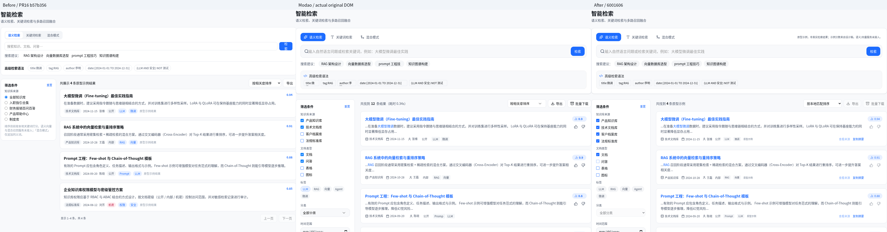
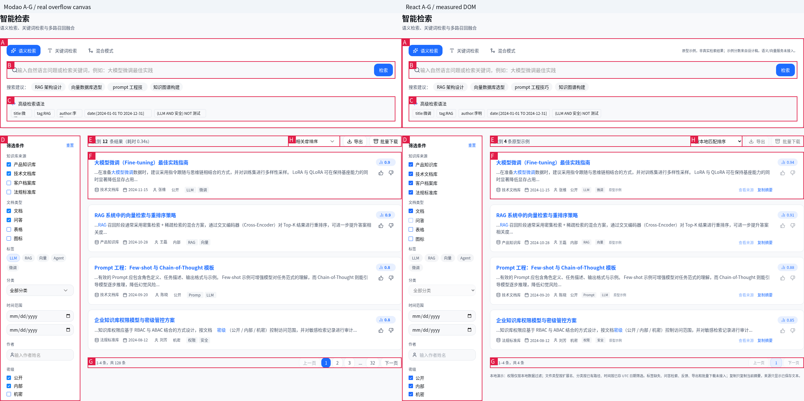
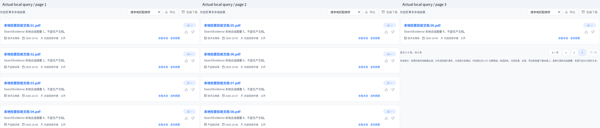

# PR #16：智能检索独立验收与高保真修复报告

日期：2026-11-05 UTC。复用原 Codex Cloud、完整墨刀 ZIP、现有 Playwright 工程与 8080/8081 前端/原型服务器。

## 结论与版本

**界面主要结构和本地关键词交互可供人工复核；真实智能/语义检索能力尚未完成。** TypeScript、开发构建退出 0；原有 53/53、新增检索专项 24/24，最终 **77/77**。原有 53 项脚本及其共同就绪 helper 与 PR #15 逐字节一致，未删除/跳过断言，见 `prior-53-script-integrity.json`。

- 分支：`feat/modao-search-visual-phase1`。
- 原 PR #16 head：`b57b356ce2c917348573b8d6b35e2b574f05dfae`；已确认与 PR #16 引用一致。
- 基线 PR #15：`2d0c297410adfd2dbcafd7daaa48f0b00505fda7`；检出前工作树干净。
- 最终受测代码：`6001606bf6ccb7aded2b769a051ea49e2544acac`。最终原有回归与检索专项使用该业务源码；采集工具提交 `95a15f8cef39db30f33dbc14f7a5c201de68565c` 仅修复原型长图容器裁剪，不改业务源码或回归断言。V15 隔离重跑在该采集提交上执行；业务源码及全部回归脚本与 `6001606` 完全一致。后续仅报告与证据提交。
- Node.js `v24.22.1`、npm `11.9.0`、系统 Chromium `155.0.8059.79`。
- 未修改 main、未合并 PR、未接生产数据、模型、向量库或下载服务。

## 命令、退出码与统计

先运行类型/构建和全部原有 53 项，完成后才修改业务文件；最终再次先完成构建，再冻结文件串行执行 77 项，避免热更新污染。最终所有 trace 扫描没有 hot update / page reload 事件。

| 命令 / 套件 | 原 PR #16 | 最终受测代码 |
| --- | --- | --- |
| `npm run typecheck` | 退出 0 | 退出 0 |
| `npm run build:dev` | 退出 0 | 退出 0 |
| `modao-pr11-regression.mjs` | 6/6，退出 0 | 6/6，退出 0 |
| `modao-v16-regression.mjs` | 15/15，退出 0 | 15/15，退出 0 |
| `modao-v15-regression.mjs` | 19/19，退出 0 | 19/19，退出 0 |
| `modao-library-regression.mjs` | 13/13，退出 0 | 13/13，退出 0 |
| 新增 `modao-search-regression.mjs` | 7/20，退出 1 | 24/24，退出 0 |
| 原型/React/9 条结果页 1、2、3 采集 | 原图采集退出 0 | 全部退出 0 |
| 原 SVG 提取、ZIP inventory | 原 ZIP 复用 | 退出 0 / 0 |

完整参数、工作目录和退出码在三个包的 `commands.json`，stdout 与 `.exit` 原样保留。最初新增 20 项脚本已另存；后续增加分类、标签、URL、空查询/窄屏四项，没有删除前 20 项。本轮未要求、也未宣称运行完整 `npm test`。

## 原始失败诊断与最小修复

原有 53 项在原 PR #16 已全部通过，不能把这些说成回归失败。新增验收 13 项失败涵盖确定的代码问题和原型要求尚未具备的控件；后者不等于既有功能被破坏。

| 优先级 / 部位 | 实际复现证据 | 修复 |
| --- | --- | --- |
| P1 文档重复与列表键 | 3 文档各 3 切片被计为 9 条；`doc.id-score-text前12字` 产生重复 key。翻页后的实际 DOM 标题遍历甚至出现 15 项，console 明确报 `Encountered two children with the same key` | 按已授权、已索引文档选择一个最高词匹配片段；每文档只出现一次，以 doc.id 为稳定 key |
| P1 固定截断 | 17 条一切片文档仅展示 total=12，余下文档不可达 | 不再使用固定 12 切片的页面候选上限；完整扫描当前本地可读文档再分页，仍是本地演示算法 |
| P1 假相关度 / 假耗时 | 原始词匹配分 8.25 被公式显示为 0.93；轨迹耗时固定 34ms | 真实结果显示“相关度未计算 / —”，不换算概率；轨迹保留原始词匹配分并注明不是语义相关度，耗时以 performance.now 实测 |
| P1 时间排序 | 时间值并未排序，仅 reverse；夹具最新为 doc02，却显示 doc09/doc08/doc07/doc06 在前 | 使用实际 updatedAt 降序，非法/未记录日期排后；排序变更复位第一页 |
| P2 布局 | 检索卡 `(448,164,1280,209)`，语法条 `(465,313,1246,43)`，筛选/结果区域与原型不符 | 结果工具栏按钮水平内边距由 12px 校准为 11px，排序起点从 1359 对齐至 1363；恢复整卡、56px 查询框、80px 语法条、256px 筛选栏、结果卡与分页锚点，使用真实 SVG |
| P2 筛选 | 知识库为单选；文档类型、时间、作者、密级等未具备完整本地过滤 | 多知识库 checkbox、已有字段组合筛选、明确分类路径匹配、真实时间范围及重置；缺失字段不猜造 |
| P1 复杂语法边界 | `title:微调` 被普通分词路径当作已经执行的查询，没有明确提示 | 标签只填草稿；title/tag/author/date 和大写布尔运算式明确提示“不支持高级语法解析”，不假装解析成功、不增加执行计数 |
| P2 结果操作 | 标题/来源/复制、反馈、批量下载缺口；原导出已有“未生成文件”说明，但仍是可点击说明入口 | 本地正文查看、真实 Clipboard 成功与失败闭环；反馈/导出/批量下载明确禁用。未把原导出误写成已伪造成功 |
| P2 状态一致性 | URL 查询更新未主动清页；未提交草稿与检索执行态需要区分 | 输入草稿/已提交查询分开；条件、模式、排序、URL 变更正确复位；空提交不恢复为示例结果。补查发现本轮中间版本在全局搜索跨入本地时残留 disabled+selected 示例标签，已统一清除跨数据域条件并扩充 URL 用例；本地查询之间保留条件 |

修改集中在 `search.tsx`、专用 CSS、新增纯本地 `local-search.ts`、13 份原 SVG 与新的检索验收工具。未改全局查询/问答引擎、store、V15/V16、知识管理业务或权限规则。

原始 13 项失败索引如下；完整 call log、console、PNG 与 trace 在诊断包：

| 用例 | 原始失败首行 |
| --- | --- |
| `unique-documents` | AssertionError [ERR_ASSERTION]: Each document appears once even when several chunks match |
| `no-fixed-result-cap` | AssertionError [ERR_ASSERTION]: Search total must not silently stop at 12 hits |
| `real-time-sort` | AssertionError [ERR_ASSERTION]: Latest date is doc 02, not reverse input order |
| `no-fabricated-relevance` | AssertionError [ERR_ASSERTION]: A local keyword score is not semantic relevance |
| `multiple-knowledge-bases` | TimeoutError: locator.uncheck: Timeout 5000ms exceeded. |
| `document-type-filter` | AssertionError [ERR_ASSERTION]: Expected values to be strictly equal: |
| `date-author-level-filters` | TimeoutError: locator.fill: Timeout 5000ms exceeded. |
| `advanced-syntax-is-not-a-parser` | TimeoutError: locator.waitFor: Timeout 5000ms exceeded. |
| `scope-mode-sort-do-not-inflate-audit` | TimeoutError: locator.waitFor: Timeout 5000ms exceeded. |
| `exports-feedback-unavailable` | AssertionError [ERR_ASSERTION]: 导出 |
| `local-source-and-copy` | TimeoutError: locator.click: Timeout 5000ms exceeded. |
| `clipboard-failure-no-fake-success` | TimeoutError: locator.click: Timeout 5000ms exceeded. |
| `source-layout` | AssertionError [ERR_ASSERTION]: Expected values to be strictly deep-equal: |

注意原分支 **0/1/4/5/9 的基本页边界本来就通过**，本轮没有把它们误报成失败。实际新增解决的是切片重复/键冲突、固定截断、排序、条件/状态、控件及能力真实性。

## 中间轮异常与复核

在 `63b2280` 并发运行多个 Chromium 套件时，旧 V16 `keyboard-layering` 的 `Return focus to actual opener` 即时断言单次失败（V16 14/15，退出 1）。未改 V16 业务代码、旧测试或其断言。trace 记录 Escape 返回后立即 evaluate；失败截图已显示实际 opener 焦点框。现有 Radix FocusScope 在 `setTimeout(0)` 中派发卸载 autofocus，支持“即时读取与异步归还竞争”的诊断，但单张截图不足以证明所有调度情况下稳定。完整失败 trace/原生与共同字体截图、结果和日志保存在诊断包 `v16-intermediate-focus-failure/`。

随后串行轮 V15 `summary-dirty-status` 也曾超时（18/19，退出 1）。trace 显示点击保存前后发生了同页文档级重新导航，恰在验收说明 Markdown 写入后约 36ms；没有运行时错误，不能把这次被文件写入污染的运行认作业务保存缺陷。此次项目内文档写入是验收操作疏漏，已停止测试期间的全部项目写入，并单独完整重跑 V15 的 19 项。原失败 PNG/trace/JSON 原样保存在诊断包 `v15-intermediate-reload/`，不归并为通过。

最终各套件完整执行结果见统计（V15 为隔离重跑的完整 19 项）；保留此次异常为自动化时序可靠性观察，未通过删断言、增加 sleep 或静默重试掩盖失败。最初基线 53/53 和前一完整中间轮 77/77 的 JSON 也保留。

全局 URL 数据域残留为本轮恢复筛选时发现的中间版本缺陷，不能倒算为原 PR #16 已有失败。`url-domain-before.png/json` 保存“LLM 仍 selected=true 且 disabled=true”的真实现场；修复后在原 URL 用例保留既有清页断言并增加跨域断言与截图。

## 布局、原资源与实际截图

统一 1920×1080、DPR1、100% 缩放。浏览器实际读取 innerWidth/innerHeight/devicePixelRatio/visualViewport.scale，两端分别为 1920/1080/1/1；共同字体 computed fontFamily 均为 Noto Sans CJK SC。标题 24px/700、筛选标题 14px/700、语法标题 14px/400 均已核对，见 `font-viewport-proof.json`。原生帧与共同字体帧分别保留，未宣称 PingFang 原生字形签收。





[同视口完整对照](pr16-search-full-viewport.png)。原型通过真实离线“总览→智能检索→演示”采集，保存 editor/native/common-font 帧；沿用既有真实 zoom-area DOM/SVG 1:1 采集方法，没有图片重绘或假页面。

原型的筛选尾部、第四卡与分页延伸至 y1324：除了原始 1920×1080 顶部帧，另存同一 viewport 下真实 DOM 溢出画布的 1920×1324 图。初版补充长图仅延长宿主，仍被原型嵌套容器裁掉底部；该环境采集缺陷已修复。最终补充图仅对 24 个大画布/滚动容器解除 overflow 裁剪，348 个 data-cid 元素的全部矩形前后严格相等，实际 viewport 仍为 1920×1080/DPR1，见 `source-overflow-audit.json`。它是明确标注的“展开裁剪的源 DOM 补充图”，不能冒充未经处理的原始视口图。原生顶部帧在修改前保存，完整保留；未重绘或补造设计内容。React 同样保留 full-page 图。衍生裁剪/编号图与原图分目录。

| 锚点 | 原型 `(x,y,w,h)` | 原 PR #16 | 修复后 | 修复后差值 |
| --- | --- | --- | --- | --- |
| A 横向检索卡 | `[445, 168, 1280, 286]` | `[448, 164, 1280, 209]` | `[445, 168, 1280, 286]` | `[0, 0, 0, 0]` |
| B 检索输入区 | `[466, 241, 1238, 56]` | 未记录 | `[466, 241, 1238, 56]` | `[0, 0, 0, 0]` |
| C 高级语法条 | `[466, 353, 1238, 80]` | `[465, 313, 1246, 43]` | `[466, 353, 1238, 80]` | `[0, 0, 0, 0]` |
| D 左侧筛选栏 | `[445, 478, 256, 846]` | 未记录 | `[445, 478, 256, 846]` | `[0, 0, 0, 0]` |
| E 结果工具条 | `[724.984375, 478, 1000, 36]` | 未记录 | `[725, 478, 1000, 36]` | `[0.01562, 0, 0, 0]` |
| F 首张结果卡 | `[724.984375, 530, 1000, 151.5]` | 未记录 | `[725, 530, 1000, 151.5]` | `[0.01562, 0, 0, 0.0]` |
| G 结果分页 | `[724.71875, 1185.25, 1000.265625, 34]` | 未记录 | `[725, 1185.25, 1000, 34]` | `[0.28125, 0.0, -0.26562, 0]` |
| H 排序下拉框 | `[1362.984375, 478, 166, 36]` | `[1522, 389, 140, 36]` | `[1363, 478, 166, 36]` | `[0.01562, 0, 0, 0]` |

“未记录”表示最初采集器没有收录该类元素的几何，不能据此称原控件不存在。基线已有分页，其位置仍可从原始 PNG 比较。结果第 2/3/4 张卡分别位于 y697.5、865、1032.5，前 3 张高 151.5、末张示例高 128.75；参考示例文字与高亮已按源 DOM 修正。

资源来自完整 ZIP `prototype/智能知识库V1.0.zip`，SHA256 `8c585bc0e158a22603410dc2578bf6fe9b6e6207285b124dd4eaf45c0646603b`。13 份 SVG 通过真实 widget data-cid 在 ZIP 的 data.1.js gzip 载荷中确认，保持 viewBox/绘图路径不变；仅序列化实际继承 paint，UI 用 alpha mask/currentColor 呈现选中颜色。导出前后 13 份几何全部相等，原 SVG、输入 geometry、导出 SHA 与 ZIP 来源均可复核。未用近似图标代替。

## 分页和状态实测

| 实际匹配文档数 | 每页内容数量 | 遍历不同文档数 | 边界 |
| --- | --- | --- | --- |
| 0 | 0 | 0 | 首/末页正确禁用 |
| 1 | 1 | 1 | 首/末页正确禁用 |
| 4 | 4 | 4 | 首/末页正确禁用 |
| 5 | 4 + 1 | 5 | 首/末页正确禁用 |
| 9 | 4 + 4 + 1 | 9 | 首/末页正确禁用 |



这里的“实际”指独立 context 内 9 条明确标注的合成记录，经本地关键词函数真实执行；不是生产知识。三组截图都通过真实检索按钮和下一页操作获得，统一滚动回顶部，未直接改 React 页码或伪造成功响应。每页完整原图/长图另存，图中裁剪只是用于展示标题变化。

- 9 条记录第 1/2/3 页分别 01–04、05–08、09；第 1 页上一页禁用，末页下一页禁用；17 条也能完整遍历。
- 同文档多片段合并为一条最佳已存片段；不把候选切片数称为文档数，页间无重复/残留 DOM。
- 多选知识库在维度内 OR，类型/密级同理，维度之间 AND；全部取消即 0 条，不把空选择偷偷改成全部。
- 排序、模式和侧栏条件改变应用于**已提交**查询，并回到第一页；输入框未提交的草稿不会偷偷改变结果。URL q 改变同步输入/执行态并清页。
- 重置清侧栏条件和示例标签，保留当前查询、模式及排序；分页/筛选/排序不增加执行次数或轨迹。计数与轨迹只在显式检索/建议触发的有效普通关键词执行时增加；URL 恢复不补造历史轨迹。
- 进入本地检索时会清除只作用于原型示例的筛选，并明确提示；不会把示例标签误当本地元数据。上述默认/重置策略仍需正式产品确认。

## 24 项检索专项

| 用例 | 浏览器验证 | 结果 |
| --- | --- | --- |
| `boundary-0` | 0 条：空列表、共 0 条、前后均禁用，无原型示例冒充结果 | 通过 |
| `boundary-1` | 1 条：仅此文档、首末页均禁用 | 通过 |
| `boundary-4` | 4 条：完整单页、首末页均禁用 | 通过 |
| `boundary-5` | 5 条：实际 4+1，翻页内容改变，无丢失/重复 | 通过 |
| `boundary-9` | 9 条：实际 4+4+1，遍历 9 个不同标题，分页不增加次数/轨迹 | 通过 |
| `unique-documents` | 3 文档各 3 切片：仅 3 文档，不重复 React key/DOM | 通过 |
| `no-fixed-result-cap` | 17 文档全部可达，不被旧 12 切片上限截断 | 通过 |
| `real-time-sort` | 按真实更新时间降序，最新 doc02 在前，重置页码 | 通过 |
| `no-fabricated-relevance` | 真实结果显示相关度未计算，轨迹为原始词匹配分及实测本地耗时 | 通过 |
| `multiple-knowledge-bases` | 知识库 checkbox 多选 OR；两库均取消得 0，恢复多选得 9 | 通过 |
| `document-type-filter` | 按已有文件名区分文档/CSV/PNG；问答实体不可用 | 通过 |
| `date-author-level-filters` | UTC 起止日期与作者组合、日期倒置提示、重置恢复 | 通过 |
| `advanced-syntax-is-not-a-parser` | title: 示例只填入，执行明确拒绝语法解析，不增加执行计数 | 通过 |
| `scope-mode-sort-do-not-inflate-audit` | 模式、排序、页码联动，不虚增搜索次数/轨迹 | 通过 |
| `query-draft-and-submit` | 未提交草稿不改变结果，提交后清页并更新 | 通过 |
| `acl-does-not-leak` | 本地普通用户看不到受限/ACL 禁止文档，轨迹也不含其标题 | 通过 |
| `exports-feedback-unavailable` | 导出/批量下载/正负反馈禁用，无下载事件或假成功 | 通过 |
| `local-source-and-copy` | 真实 Clipboard 写入并读回；打开对应本地正文、Escape 关闭 | 通过 |
| `clipboard-failure-no-fake-success` | 负向注入 NotAllowedError，只报失败、不报已复制 | 通过 |
| `category-path-filter` | 按明确已存分类路径分段筛选，重置恢复 | 通过 |
| `tags-are-reference-only` | 原型标签仅过滤示例；进入本地后清除并禁用，不猜标签字段 | 通过 |
| `client-url-query-resets-page` | URL q 同步并清页；原型示例经全局搜索进入本地，清除且禁用示例标签 | 通过 |
| `empty-query-and-responsive` | 空提交不退回示例、不增加次数；1280/800/375 无页面横溢 | 通过 |
| `source-layout` | 检索卡、筛选栏及结果首卡真实几何对齐原型 | 通过 |

原有 53 项的完整最终 PNG/trace 在独立包，包含 B01/B02/B03/B05、V15/V16、知识管理；新增 `prior-53-script-integrity.json` 证明四份原脚本与共同 ready helper 与已验收 PR #15 完全一致。

剪贴板正向用例实际授予浏览器权限、调用 navigator.clipboard.writeText 并用 readText 读回文本；不是只看 toast。负向用例仅在隔离测试中让该 API 抛 NotAllowedError，验证失败文案且无“已复制”；没有用假成功 API 替代正向验证。来源打开当前对应文档的已存全文，不伪造 PDF 文件或地址。

## 真实性与未接入能力

| 控件 / 名称 | 本轮实际能力 | 不能宣称的能力 |
| --- | --- | --- |
| 语义检索 | 名称/状态还原；明确提示本次回退本地关键词匹配 | Embedding、向量召回、语义理解 |
| 关键词检索 | 对已授权、已索引本地记录的标题/片段词频匹配 | 专业检索服务、服务端索引或完整语言分析 |
| 混合模式 | 仅既有固定同义词字典扩展后做同样的本地匹配 | 多路召回、RRF、交叉编码器重排 |
| 相关度 | 真实结果为“未计算 / —”；本地原始词匹配分仅在带说明的轨迹中保留 | 真实相似度/模型概率/统一 0–1 服务分值 |
| 参考分数/计数/耗时 | 4 条原型示例逐条标注；0.94 等仅为源设计示例。真实计数按实际集合，轨迹计时为实测本地扫描时间 | 把设计稿的 128、0.94、0.34s 当成服务返回。界面没有复制假的耗时 |
| 高级语法 | 填入示例，提交明确拒绝不支持的语法；可改用普通关键词/已有字段 | title/tag/author/date/AND/NOT 语法解析 |
| 类型/分类/日期/作者/密级 | 文件名扩展名、明确已有路径分段、已存 UTC 日期/owner/sensitivity；本地权限过滤 | 实际文件解析、企业分类字典、真实服务端鉴权 |
| 标签 | 原型示例数组有标签可筛；真实记录无独立标签字段时清除并禁用 | 从正文猜造或回填真实标签 |
| 问答类型 | 禁用并说明缺少问答实体检索 | 把普通文本假作问答检索结果 |
| 查看来源 / 复制 | 对应本地正文；真实复制当前片段，异常不报成功 | 原文件访问/下载、PDF 页码、云端来源服务 |
| 反馈/导出/批量下载 | 恢复可见入口，明确禁用；无成功提示、无生成文件 | 已提交反馈、训练闭环或真正文件下载 |

默认设计示例不是已经执行的检索；每张都标明“原型示例”，页面顶部也明确。提交空查询后为 0，不会退回示例。原型自身勾选状态、128 条静态总数与四条设计内容并非可验证业务数据，因此没有照搬为真实过滤语义。

原型点击首条还会显示一个通用 RAG 文档模板，而非同名真实来源；已保存该点击的 editor 帧/文本作为设计证据，没有据此伪造文件阅读器、AI 摘要或来源映射。

## 异常日志与证据完整性

| 最终套件 | 页面运行时异常 | console error 条数 | failed request 条数 |
| --- | --- | --- | --- |
| pr11-final | 0 | 38 | 38 |
| v16-final | 0 | 50 | 50 |
| v15-final | 0 | 54 | 54 |
| library-final | 0 | 34 | 34 |
| search-final | 0 | 104 | 104 |

最终 pageerror 全为 0；console/request 错误均为外部 Google Fonts 与 Grok 扩展被代理阻断（ERR_TUNNEL_CONNECTION_FAILED），原样保留，未写成零控制台错误。基线重复 key 的 React 警告属于真实代码问题，已另行修复，不能混算成环境错误。

24 项检索专项实际记录 7624 个 GET（含开发 WebSocket 握手）；HTTP 写请求为空，浏览器 origin 仅 localhost、外部字体、Grok 与本地开发 WebSocket，未观察到模型/向量/反馈/下载 API 调用。该观察不等于存在后端服务，源代码仍仅调用本地匹配函数。

三包都有逐文件 SHA256 manifest、PNG 解码验证、ZIP CRC；画廊在实际 Chromium 中打开并检查图片引用和展开用例数。最终 77 份 trace 无 HMR 干扰。所有秘密/权限/搜索夹具均为本地合成数据，未接入生产。

## 仍需人工确认

1. PingFang 原生字体、全局壳层（品牌/全局导航行高等）的既有差异，是否接受共同字体做当前结构复核。原型文字/数值框有裁剪，不为逼近截图去裁掉完整信息；整页原生像素签收尚未完成。
2. 是否保留默认 4 条原型示例；上线应替换为空态或真实服务。真实查询分数不能沿用设计值。
3. 原型多选默认值、空选择、跨维度组合、进入本地时清示例筛选、重置范围是否采用当前规则；这些已明确记录但未当成不可变产品规范。
4. “图标”类型原型用词的具体含义、真实 MIME/类型、标签、分类体系、原文件地址与可下载材料的数据模型；当前仅使用已有字段及明确路径，不猜模型。
5. 日期采用已存 UTC 日期，正式业务时区/时间字段、刷新后是否保留筛选/模式/排序、是否联动 V16 检索偏好及正式每页条数待确认；目前仅 URL q 可恢复。
6. 真正向量/语义/混合/复杂语法/排序服务、权限校验、反馈及导出下载协议均未接入。只有本地 UI/关键词流程可供复核，不能标为完整智能检索上线完成。
7. 本地正文查看不等于完整文档阅读原型；原型通用文档模板与点击条目的关系、真实文件阅读方案需另行定义。其他浏览器尚未签收。

## 下载与复现

三个包请**分别解压**，打开各自 index.html，避免覆盖同名 manifest/index。

- [检索视觉、24 项专项、真实 SVG、9 条结果分页及源码差异](pr16-search-visual-evidence.zip)
- [原有 53 项完整最终截图、结果与 trace](pr16-existing-53-regression-evidence.zip)
- [原始 20 项失败诊断、修复前图、原型点击证据](pr16-search-baseline-diagnostics.zip)

同目录 `.sha256` 校验 ZIP；每包 `commands.json`、`provenance.json`、`manifest.json` 可追溯执行和来源。基线 20 项脚本原样保留，便于在 b57b356 隔离检出后重现，未用最后 24 项冒充原始轮次。

```bash
npm run typecheck
npm run build:dev
npm run dev
# 冻结项目文件后复用原有 53 项，不在测试期间格式化/写源码
IKB_PR11_OUTPUT=artifacts/modao-v1/pr16-core node scripts/modao-pr11-regression.mjs
IKB_V16_OUTPUT=artifacts/modao-v1/pr16-v16 node scripts/modao-v16-regression.mjs
IKB_V15_OUTPUT=artifacts/modao-v1/pr16-v15 node scripts/modao-v15-regression.mjs
IKB_LIBRARY_TEST_OUTPUT=artifacts/modao-v1/pr16-library node scripts/modao-library-regression.mjs
IKB_SEARCH_TEST_OUTPUT=artifacts/modao-v1/pr16-search node scripts/modao-search-regression.mjs
IKB_SEARCH_OUTPUT=artifacts/modao-v1/pr16-visual node scripts/modao-search-visual-capture.mjs
IKB_SEARCH_CAPTURE_MODE=react IKB_SEARCH_FIXTURE=live9 IKB_SEARCH_PAGE=3 IKB_SEARCH_OUTPUT=artifacts/modao-v1/pr16-live-page3 node scripts/modao-search-visual-capture.mjs
```

全部浏览器脚本限制 localhost；不修改 main、不合并 PR、不访问生产环境。
